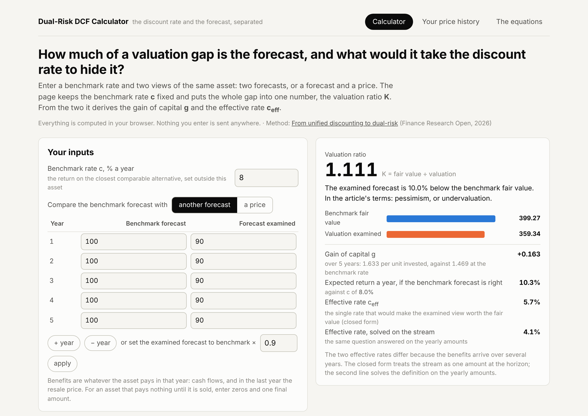

# Dual-Risk DCF Calculator

[](https://github.com/apapadogiannis/dual-risk-calculator/actions/workflows/check.yml)

How much of a valuation gap is the forecast, and what would it take the discount rate to hide it?
Enter your own forecasts or your own prices and get the answer in two numbers.

**Page: https://apapadogiannis.github.io/dual-risk-calculator/**

By [Agisilaos Papadogiannis](https://github.com/apapadogiannis).



## Use it from your own AI agent

The same calculations run as an MCP server on your own machine. It has no network access and stores
nothing. For Claude Code:

```bash
claude mcp add dual-risk -- uvx --from git+https://github.com/apapadogiannis/dual-risk-calculator dual-risk-mcp
```

For any other MCP client, the command is `uvx` with the arguments
`--from git+https://github.com/apapadogiannis/dual-risk-calculator dual-risk-mcp`. It needs
[uv](https://docs.astral.sh/uv/) and Python 3.10 or later.

Then ask, for example, "my forecast is 90 a year for five years and the benchmark forecast is 100;
at 8%, what is K and the effective rate?".

`api/SKILL.md` is a skill: a short file that tells an agent when to use the calculator and how to
read its results. For Claude Code:

```bash
mkdir -p ~/.claude/skills/dual-risk-calculator
curl -o ~/.claude/skills/dual-risk-calculator/SKILL.md https://apapadogiannis.github.io/dual-risk-calculator/SKILL.md
```

## For AI agents and programs

Read [`api/llms.txt`](api/llms.txt) first. It says what the calculator computes, what it adds over
doing the arithmetic yourself, how to read each figure, and what not to use it for.

| Tool of the server | What it does |
|---|---|
| `compare_forecasts` | two forecasts of the same asset: both values, K, g, c_eff |
| `compare_with_price` | a forecast against an observed price |
| `perpetuity` | the constant-growth case |
| `convert` | between K and g at a given c and horizon |
| `market_clearing_price` | the price that clears a market of agents with different K |
| `price_history` | the article's back-test on a series of total-return prices |

`dualrisk/core.py` is the same set of formulas as a Python module with no dependencies. The guide
and the skill are written by `build.py` and checked by the tests. Do not edit them by hand.

## What it is

A discounted cash flow value has a numerator, the expected benefits, and a denominator, the discount
rate. One rate is usually asked to do two jobs: stand for what the money could earn elsewhere, and
absorb doubts about the forecast. The calculator gives each job its own number, following
[From unified discounting to dual-risk: A new lens on DCF valuation](https://doi.org/10.1016/j.finr.2026.100096)
(Papadogiannis 2026, *Finance Research Open*):

```
c      benchmark cost of capital, set outside the asset
K      valuation ratio = fair value at c / the valuation examined
g      gain of capital = (1 + c)^h (K - 1)
c_eff  effective rate  = (1 + c) K^(-1/h) - 1
```

The page has three views:

1. **Calculator.** A benchmark rate and two views of the same asset: two forecasts, or a forecast and
   a price. It returns both values, K, g and c_eff, and says in words which view is below or above
   the benchmark and by how much.
2. **Your price history.** Paste or load a series of prices. For every date with a price one horizon
   later it computes the realized K, with summary statistics, a chart and a file to download. The
   benchmark rate is one you set, or the rule of the article's illustration (the asset's own
   trailing return with a floor).
3. **The equations.** Every term explained, with the equation number of the article.

It computes from your numbers. It holds no market data and forecasts nothing.

## Privacy

The page computes in your browser. It loads no library and sends nothing: the numbers you type and
the file you choose stay on your machine. The MCP server runs locally over stdio and opens no
network connection.

## Quickstart

Python 3.10 or later, and Node.js for the page test.

```bash
pip install -r requirements.txt
python3 -I tests/test_core.py          # the formulas against figures and identities of the article
python3 -I tests/test_continuity.py    # the price history against the article's replication package
python3 -I tests/make_vectors.py       # test cases and their results in Python
node tests/check_page.mjs              # the page's calculations on the same cases
python3 -I tests/test_server.py        # starts the MCP server and calls every tool
python3 -I build.py                    # writes _site/ and api/
python3 -I tests/test_agent_files.py   # the guide and the skill are what the build writes
```

Open `_site/index.html` in a browser.

## Layout

```
dualrisk/core.py           the formulas, each with the equation of the article it implements
dualrisk/server.py         the MCP server
site/index.html            the page, with the same formulas in JavaScript
build.py                   builds the site and writes the guide and the skill
api/                       llms.txt (the guide) and SKILL.md (the skill)
tests/test_core.py         checks against the article
tests/test_continuity.py   the price history against the stored results in reference/
reference/                 weekly prices and results of the article's replication package
tests/make_vectors.py      test cases for the comparison of page and Python
tests/check_page.mjs       runs the page's formulas on those cases
tests/test_server.py       starts the server as a client would
tests/test_agent_files.py  checks the files in api/
```

## How the check works

The `check` workflow runs on every push. The page is published only if all of it passes.

- The formulas are tested against figures printed in the article (for example, at c = 10% and five
  years a gain of 0.2 corresponds to K of about 1.12) and against its identities.
- The price history is run on the weekly prices of the article's
  [replication package](https://github.com/apapadogiannis/dual-risk-dcf) and must reproduce its
  stored weekly series and its statistics of K, for all three assets.
- The page and the server are two implementations, in JavaScript and Python. Both are run on the
  same generated cases and every number must agree to a relative 1e-9.
- The server is started over stdio, every tool is called, and the answers are compared with the
  Python module.

The check shows that the tool computes the article's formulas. It does not show that a forecast or
a benchmark rate you enter is right.

## Limits

- K measures the distance between two views at a given c. It does not say which view is right.
- Every result depends on the benchmark rate, which is an input.
- The reading from prices is hindsight: each K uses a price one horizon later.
- The article's closed form for c_eff is exact for a single payoff at the horizon. For benefits
  spread over several periods the calculator also solves the definition on the stream and shows
  both rates.

## License

Code: MIT. Text and figures of the page: CC BY 4.0. The article is open access under CC BY 4.0.

## Citation

Papadogiannis, A. (2026). From unified discounting to dual-risk: A new lens on DCF valuation.
*Finance Research Open*, 2(1), 100096. https://doi.org/10.1016/j.finr.2026.100096

Papadogiannis, A. (2026). Dual-Risk DCF Calculator.
https://github.com/apapadogiannis/dual-risk-calculator

## Disclaimer

Independent research, conducted without funding, for informational and academic purposes only. Not
financial, investment, tax or legal advice, and not a recommendation to buy or sell any financial
instrument.
